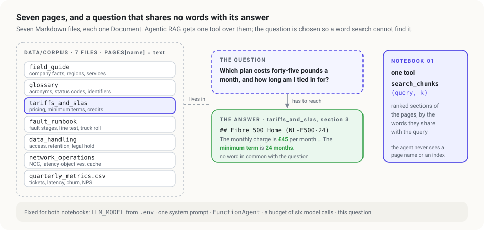
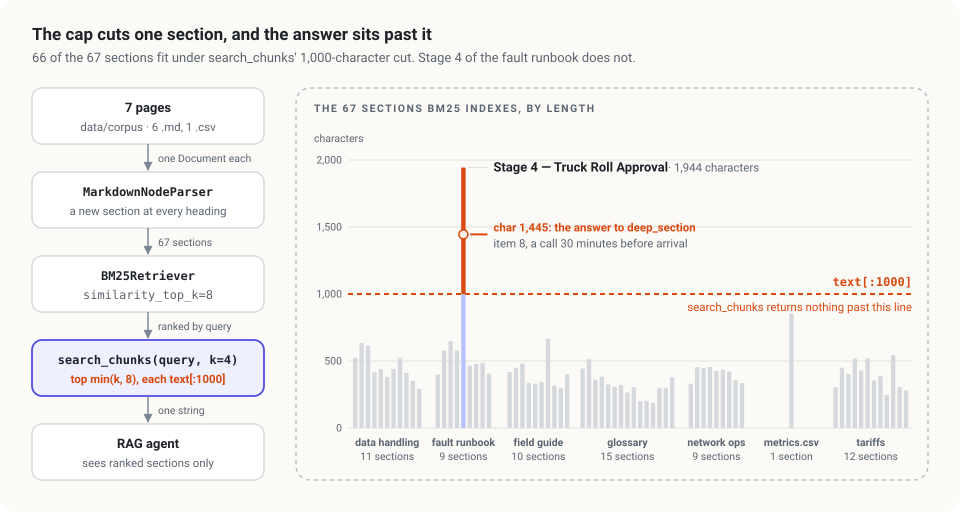
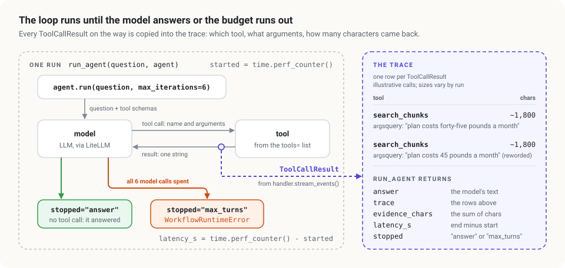
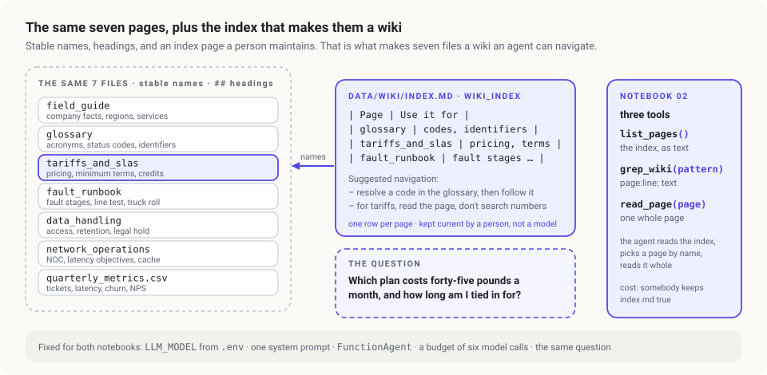
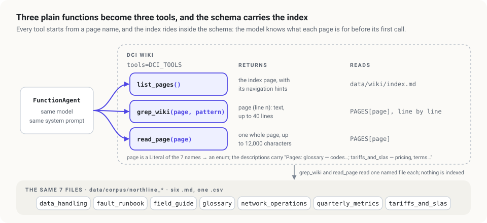
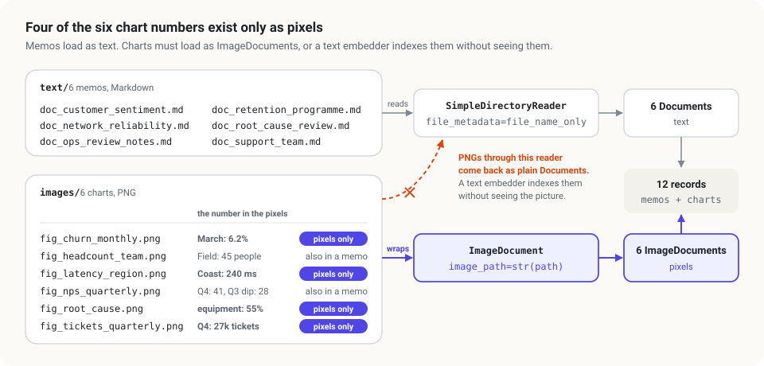
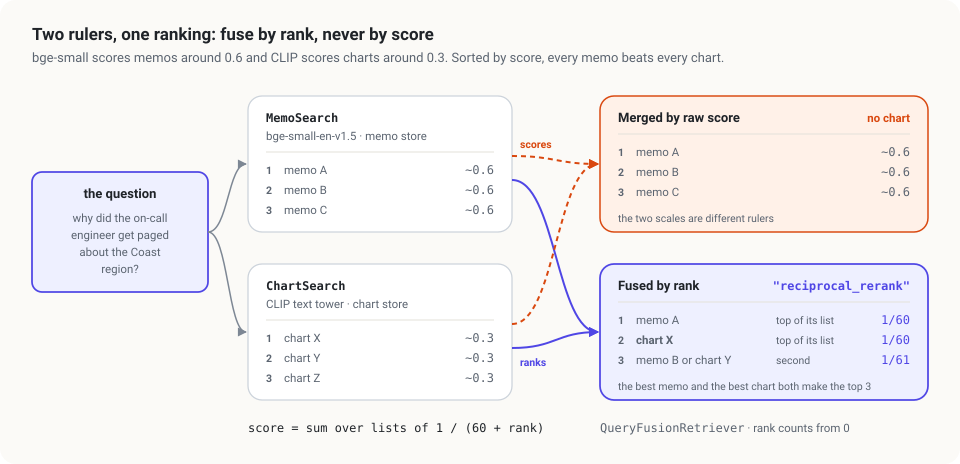
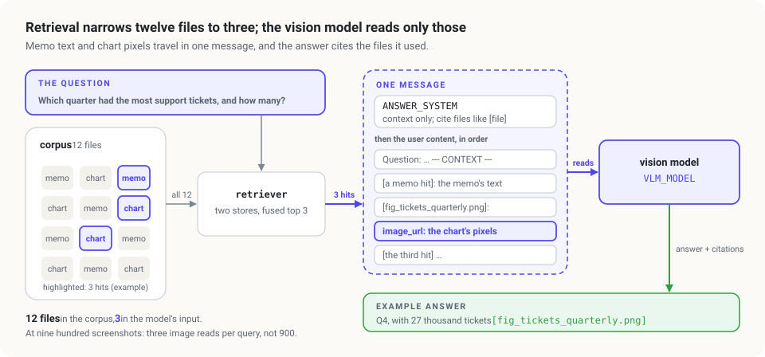
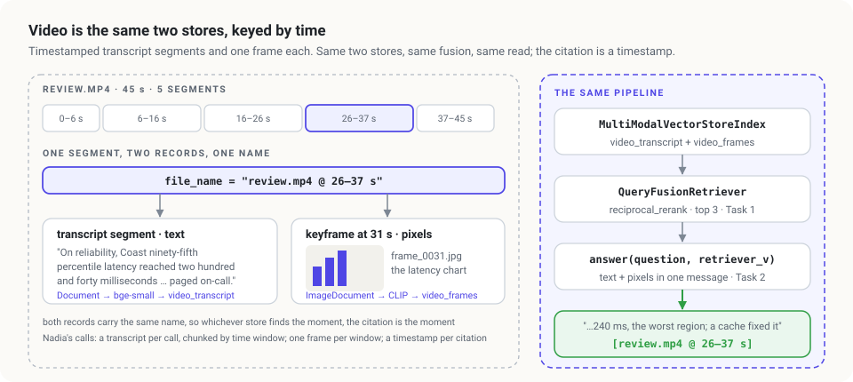

# Diagram discussions — what each picture warns about, and what the notebook does about it

Ten diagrams across the three notebooks. For each: what it shows (the warning),
and the recommended answer in the notebook's own terms. Read aloud, each entry
is about two minutes; a notebook's set is under seven. The last line of each
entry is the one to say if you only have ten seconds.

---

## 01 · Agentic RAG (7 min, three diagrams)

### Setup — "Seven pages, and a question that shares no words with its answer"

**Shows / warns.** Seven Markdown files, one `Document` each. The question —
*which plan costs forty-five pounds a month, and how long am I tied in for?* —
is answered in section 3 of the tariffs page (*£45*, *24 months*), and has no
word in common with it. The agent gets one tool, `search_chunks`, which
ranks sections by shared words. It never sees a page name or an index. The
bottom strip is what stays fixed in 02: model, prompt, agent class, budget,
question.

**Answer in the notebook.** None yet, on purpose: this diagram sets the trap.
Keyword retrieval can only find text that shares words with the query, so
the agent will have to reword until the words match. The honest fix is the
one every production system ends up with: a dense or hybrid retriever under
the same `search_chunks` signature, which is one function change and leaves
the experiment intact.

*Say:* "The question is chosen so a word search cannot find it. Watch what the
agent does about that."

### Task 1 — "The cap cuts one section, and the answer sits past it"

**Shows / warns.** Left: pages → `MarkdownNodeParser` (a section per heading)
→ 67 sections → BM25 → `search_chunks` returns the top k, each cut at 1,000
characters. Right: all 67 sections by length. One, the fault runbook's
*Stage 4 — Truck Roll Approval*, is 1,944 characters, and the answer to one
eval question sits at character 1,445. BM25 can rank that section first and
the agent still never sees the sentence. The cap is visible here only
because it is one line in a function; every chunk retriever has one somewhere
(chunker window, top-k, context budget), usually inside a library default.

**Answer in the notebook.** Not "raise the cap" — that moves the problem to
the next long section. Two things: make the cap measurable, by tracking
*evidence read* next to pass rate so truncation shows up as *right section,
missed answer*; and know the other interface's cap before choosing. Notebook
02's `read_page` returns the whole page (12,000 chars) and `grep_wiki`
returns the line wherever it is, so the Truck Roll answer survives — at the
price of more characters read per question and a maintained index.

*Say:* "BM25 did its job; the function's last line threw the answer away.
Find your line and put it in the eval."

### Task 2 — "The loop runs until the model answers or the budget runs out"

**Shows / warns.** The grey frame is `run_agent`: `agent.run(question,
max_iterations=6)`, the model either asks for a tool or answers, a tool call
returns one string, repeat. Two exits: green, the model answered; orange, six
model calls spent and `WorkflowRuntimeError`. The right panel is the trace:
one row per `ToolCallResult` — tool, arguments, characters returned — then
answer, evidence chars, latency, how it stopped. The warning is the orange
exit: a loop with no budget has no upper bound on cost, and a loop with no
trace cannot be audited, replayed or priced.

**Answer in the notebook.** `max_iterations` as a hard budget, counted in
model calls so the answer itself costs one; and the trace captured from the
event stream rather than reconstructed afterwards. The four numbers in the
closing row (calls, evidence chars, latency, stopped) come straight from this
cell and are what the comparison with 02 is built on.

*Say:* "The budget is the only thing between you and an unbounded bill; the
trace is the only thing an auditor can read."

---

## 02 · LLM Wiki / DCI (7 min, three diagrams)

### Setup — "The same seven pages, plus the index that makes them a wiki"

**Shows / warns.** Same files. New in the middle: `index.md`, one row per page
saying what it is for, plus navigation hints, written and kept current by a
person. Right: three tools — list the index, grep one page, read one page by
name. The warning is in the caption under the index: *the cost is that
somebody keeps index.md true.* Without stable names and a maintained index
there is nothing to navigate, and a stale index sends the agent to the wrong
page with full confidence.

**Answer in the notebook.** Treat the index as a product artefact with an
owner (Knowledge Operations), not generated text; keep page names stable;
and put the structure where the agent cannot miss it — the next diagram.

*Say:* "Same corpus. The difference is a page a person maintains, and that
is both the power and the bill."

### Task 1 — "Three plain functions become three tools, and the schema carries the index"

**Shows / warns.** `FunctionAgent` with three tools. `list_pages` returns the
index. `grep_wiki(page, pattern)` searches *one named page* and returns lines
with line numbers, capped at 40. `read_page(page)` returns one whole page,
capped at 12,000. `page` is a `Literal` of the seven names, so the schema
carries an enum, and the tool descriptions carry the index text itself. The
warning is what happened before this design: with a corpus-wide grep and an
index the model had to choose to call, the model grepped three times and
never touched the index — a word search again, reworded like RAG.

**Answer in the notebook.** Structure in the interface, not in instructions.
Scope grep to a page (which is also where a permission filter lives), and
put the page names and purposes in the schema so the model knows which page
covers tariffs before its first call. The measured result: every call names
a page, no corpus search, 541 evidence characters against 3,584 in 01.

*Say:* "Give a model a word search over everything and it searches words.
Put the index in the schema and its first move is a page name."

### Task 2 — "The loop runs until the model answers or the budget runs out"

**Shows / warns.** Deliberately the same loop as 01 — same `run_agent`, same
budget, same exits — so the only variable is the tool list. The trace panel
is the real run: two calls, both on `page=tariffs_and_slas`, 12 and 529
characters, answered with a citation. The warning is the one from 01 again:
without the identical loop and the identical trace you cannot claim the
difference came from the interface.

**Answer in the notebook.** Hold everything constant but the tools, then put
the two four-number rows side by side: same question, same two calls, a
sixth of the evidence, a trace that names its source. Neither is free: one
side rewords until words match; the other needs the index kept true.

*Say:* "Same picture as 01 on purpose. Read the args column: a page name, not
a query."

---

## 03 · Multimodal Retrieval (7 min, four diagrams; the fourth is the bonus)

### Setup — "Four of the six chart numbers exist only as pixels"

**Shows / warns.** Two folders. `text/` → `SimpleDirectoryReader` → six
`Document`s. `images/` → `ImageDocument` → six image records. Four chart
numbers (churn 6.2 %, Coast 240 ms, equipment 55 %, Q4 27 k) appear in no
memo. The orange ✗ is the trap: point the text reader at the PNGs and you
get plain `Document`s that a text embedder indexes without ever seeing the
picture — no error, just a silent blind spot.

**Answer in the notebook.** Load each modality as its own type, and know
before you index which facts live only in pixels; those are the questions a
text-only pipeline cannot answer at all, and they belong in the eval set.

*Say:* "Four of six numbers are pixels. A text pipeline doesn't get them
wrong; it never sees them."

### Task 1 — "Two rulers, one ranking: fuse by rank, never by score"

**Shows / warns.** One question, two stores: `MemoSearch` (bge-small) scores
memos around 0.6, `ChartSearch` (CLIP's text tower) scores charts around
0.3. Orange box: merged by raw score, the top 3 are three memos and no chart,
every time — two different rulers. The warning is that this looks correct;
nothing fails, the chart simply never surfaces.

**Answer in the notebook.** Reciprocal Rank Fusion: ignore the scores, keep
each list's order, give an item `1 / (60 + rank)` per list and sum. Top of
either list is 1/60 whether it scored 0.6 or 0.3, so the best memo and the
best chart both reach the top 3. Measured: the latency chart at rank 2.

*Say:* "Each embedder gets its own store and its own ruler. Merge by
position, never by score."

### Task 2 — "Retrieval narrows twelve files to three; the vision model reads only those"

**Shows / warns.** Twelve files → the fused retriever → three hits → one
message: system prompt, question, each memo as text, each chart as its file
name followed by its pixels → the vision model → an answer with citations.
The warning is implicit in the counts: CLIP can find the chart but cannot
read the number off it, and sending every image to a vision model is the
other failure — at 900 screenshots, 900 image reads per query.

**Answer in the notebook.** Narrow, then read. Retrieval picks three, the
vision model reads only those, and `k=3` is a cost control as much as a
quality control (roughly a thousand tokens per image). Measured: *Q4, 27
thousand tickets*, a number in no memo, cited to the chart.

*Say:* "Retrieval finds the chart; the vision model reads it; the model only
ever sees three files."

### Bonus Task 3 — "Video is the same two stores, keyed by time"

**Shows / warns.** A 45-second review split into five timestamped segments,
one keyframe each. One segment becomes two records with the same name,
`review.mp4 @ 26–37 s`: transcript text into the text store, the frame into
the CLIP store. Right: the identical pipeline from Tasks 1 and 2. The
warning is a quiet one: nothing new is required, which means the temptation
to build a separate "video system" is the mistake.

**Answer in the notebook.** Same two stores, same fusion, same read; the only
design decision is the record name, which carries the timestamp so the
citation is a moment a person can scrub to. Measured: the Coast question
answered from `review.mp4 @ 26–37 s`.

*Say:* "Video is text and pictures in a time series. Key both by the
timestamp and the pipeline doesn't change."

---

## The three sentences that tie it together

- 01: a keyword retriever finds what shares words with the question, up to a
  cap you may not have noticed — put both in the eval.
- 02: structure a person maintains lets the agent navigate by name instead
  of searching by word, if the structure lives in the interface.
- 03: each modality gets its own embedder and store; merge by rank, read with
  a vision model, and only ever read what retrieval kept.
